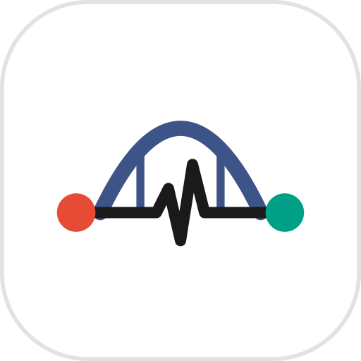

<p align="center">
  
</p>

<h1 align="center">MiHealthBridge</h1>

<p align="center">
  把<b>国行小米手环 / 手表</b>的健康数据，近实时同步到 Android <b>Health Connect</b>
</p>

<p align="center">
  <a href="https://github.com/Jack-082/mi-health-bridge/releases/latest"></a>
  <a href="https://github.com/Jack-082/mi-health-bridge/actions/workflows/build.yml"></a>
  <a href="LICENSE"></a>
  
</p>

国行「小米运动健康」（`com.mi.health`）不支持写入 Health Connect。本应用不替换官方 App，也不碰蓝牙：

```
手环 ──蓝牙──> 小米运动健康 ──上传──> 小米健康云 (hlth.io.mi.com)
                                            │  本应用定时拉取（非官方接口）
                                            ▼
                                     Health Connect ──> Google Fit / 其他健康 App
```

NFC 公交卡、支付、消息通知、表盘这些官方功能都不受影响。

## 支持的设备

本应用不直接连接手环，读取的是「小米运动健康」上传到小米健康云的数据。能否使用取决于**数据是否进入「小米运动健康」**，而不是手环型号：

| 情况 | 是否支持 |
|---|---|
| 用「小米运动健康」同步的设备（小米手环 8 及以后、Redmi 手环、小米手表等） | ✅ 支持 |
| 用「Zepp Life」（原「小米运动」）同步的设备（小米手环 1–6 等） | ❌ 不支持，数据在华米云 |
| 两个 App 都能连的型号（如小米手环 7） | 取决于实际绑定在哪个 App |
| 海外 / 国际版小米账号 | ❌ 不支持，目前只接入国内服务器 |

能同步哪些数据也取决于设备本身，例如没有 REM 分期的手环就不会有 REM 数据。

## 同步的数据

| 小米数据 | Health Connect 记录 | 说明 |
|---|---|---|
| 步数 / 距离 / 活动热量 | Steps / Distance / ActiveCaloriesBurned | 按自然日汇总，每次同步覆盖更新当天的值 |
| 心率 | HeartRate | 按整点小时打包 |
| 静息心率 | RestingHeartRate | |
| 血氧 | OxygenSaturation | |
| 睡眠（含深睡/浅睡/REM/清醒分期） | SleepSession | 每次同步先清理本应用写过的睡眠再重写，避免同一晚出现重复记录 |
| 睡眠平均呼吸率 | RespiratoryRate | |
| 运动记录 | ExerciseSession | 距离和热量写在备注里，避免和每日汇总重复计数 |
| 体脂秤：体重 / 体脂率 / 体内水分 / 骨量 / 去脂体重 / 基础代谢 | Weight / BodyFat / BodyWaterMass / BoneMass / LeanBodyMass / BasalMetabolicRate | 绑定在小米运动健康或**米家 App** 的秤都支持，见下文 |

### 米家体脂秤

绑定在米家 App 的体脂秤（如小米体脂秤 S400），称重数据也会上传到小米云。打开「米家体脂秤」开关后，应用会用同一个小米账号读取，不需要另外登录米家。

- 型号自动探测：先读取米家账号里绑定的秤的真实型号，再试已知型号：`wole.scales.mjh05`（如一 MJH-05）、`yunmai.scales.ms103`（国行 S400）、`yunmai.scales.ms107`、`xiaomi.scales.ms110`、`yunmai.scales.ms104`。
- 秤上有多位家庭成员时，必须先在界面里选择你自己，否则不写入，避免家人的体重混进你的健康数据。
- 第三方生态链秤（如「米家智联」的 MJH-05）不一定走体脂秤专用接口。可以点卡片里的「诊断」：应用会列出账号下的秤，逐一尝试体脂秤接口和米家设备历史接口（按 [MIoT 设备规范](https://miot-spec.org) 查询属性和事件），把能拿到的原始数据写进日志，方便适配新型号。
- 接口和字段参考 [SmartScaleConnect](https://github.com/AlexxIT/SmartScaleConnect)（MIT），只在中国大陆区账号上可用，未在所有型号上实测。

压力和 HRV 不同步：Health Connect 没有压力类型，小米 HRV 的口径也和 Health Connect 的 RMSSD 不同。

每条记录都有固定的 `clientRecordId`，重复同步只会覆盖更新，不会产生重复数据。

## 关于“实时”

延迟由三段组成：

1. **手环 → 小米运动健康**：手机后台与手环的同步周期，一般几分钟到几十分钟。打开小米运动健康 App 会立即触发同步。
2. **小米运动健康 → 云端**：同步后自动上传。
3. **云端 → Health Connect**：由本应用控制。默认每 15 分钟一次，可开启 2 / 5 / 10 分钟的“快速模式”。

通常能做到分钟级，但做不到秒级。真正的瓶颈是第 1 段，本应用改变不了。

## 安装

### 下载 APK（推荐）

- **国内用户**：打开 [蒲公英下载页](https://www.pgyer.com/mihealthbridge)，手机浏览器直接下载安装，始终是最新版本。
- **GitHub**：到 [Releases](https://github.com/Jack-082/mi-health-bridge/releases/latest) 下载 `MiHealthBridge-<版本>-release.apk`。

两处的安装包相同，签名证书 SHA-256 为 `ea52edcf6cbd5f15a9cd33ffc44111982a9e0c709b80324ff1b10a79368072e3`。

正式版使用固定签名，以后的新版本可以**直接覆盖安装**，登录状态、同步进度和 Health Connect 授权都会保留。

### 自行构建

**GitHub Actions**：Fork 本仓库后 Actions 会自动构建，在运行详情页的 Artifacts 里下载 `MiHealthBridge-apk`；推送 `v*` 标签时会同时发布到 Releases。

没有配置签名时，APK 使用 CI 临时生成的 debug 签名，**每次构建的签名都不同，升级前需要先卸载**。要使用固定签名：

```bash
# 生成 keystore（别名 mihealthbridge，会提示设置密码）
openssl req -x509 -newkey rsa:4096 -sha256 -days 10000 -nodes \
  -keyout key.pem -out cert.pem -subj "/CN=MiHealthBridge"
openssl pkcs12 -export -inkey key.pem -in cert.pem -name mihealthbridge -out release.p12
rm key.pem cert.pem
base64 -i release.p12 | tr -d '\n' | pbcopy   # 复制到剪贴板
```

然后在仓库 Settings → Secrets and variables → Actions 的 **Repository secrets** 中添加：

| Secret | 值 |
|---|---|
| `SIGNING_KEYSTORE_BASE64` | `release.p12` 的 base64 |
| `SIGNING_STORE_PASSWORD` | 上面设置的密码 |

密钥别名默认为 `mihealthbridge`，如需更换，在 **Variables**（不是 Secrets）中设置 `SIGNING_KEY_ALIAS`。`SIGNING_KEY_PASSWORD` 可选，不配置时沿用 keystore 密码。构建日志会注明 APK 是否已使用固定签名，以及证书的 SHA-256。

**自动上传到蒲公英**（可选，方便国内用户下载）：再添加 `PGYER_API_KEY`（在 [蒲公英 API 信息页](https://www.pgyer.com/account/api) 获取），推送 `v*` 标签时会自动上传，下载页地址显示在构建摘要里。可选的 `PGYER_PASSWORD` 会给下载页设置安装密码。如果某次上传失败，可以在 Actions 页面选择该标签手动运行一次来补传（只适用于 `v0.1.1` 及以后的标签，更早的标签还不包含这一步）。

**本地构建**：用 Android Studio 打开项目，或执行：

```bash
gradle wrapper --gradle-version 8.11.1   # 只需执行一次，生成 ./gradlew
./gradlew :app:assembleRelease
```

要求 JDK 17、Android SDK 35。

### 版本号

版本号由 Git 自动生成：`versionCode` 是提交总数，`versionName` 来自最近的 `v*` 标签（在标签上为 `0.1.0`，之后有新提交时为 `0.1.0-3-gabc1234`）。发布新版本：

```bash
git tag v0.2.0 && git push origin v0.2.0
```

## 使用

1. 确认手机上的「小米运动健康」已登录，并且手环能正常同步数据。
2. 打开 MiHealthBridge，点 **登录小米账号**，在小米官方登录页完成登录（支持短信验证）。本应用只保存登录后的 `passToken` Cookie，不接触你的密码。
3. 点 **授权写入**，在 Health Connect 中勾选全部权限。
4. 点 **立即同步**。首次使用建议先选好 **全量重同步回溯天数**（1 / 7 / 30 / 90 天），再点 **全量重同步** 补齐历史数据。
5. 建议点 **关闭电池优化**。在小米、华为等国产系统上，还需要在系统设置中为本应用开启“自启动”，后台策略设为“无限制”。小米运动健康也要同样设置。

### 界面

- 顶部用三个状态点概括 **账号 / 权限 / 同步** 是否正常（绿色正常、橙色部分完成、红色异常、灰色未开始）。
- **同步**：显示上次成功时间和结果；同步进行时会显示“同步中…”。同步间隔可选 2 / 5 / 10 / 15 分钟。
- **日志 → 最近一次同步**：逐项列出 11 类数据的结果——已同步几条、无新数据、未授权或失败（附原因）。
- **日志 → 详细日志**：默认折叠，展开后可以 **复制全部日志**，反馈问题时附上即可。日志中不包含账号凭据。
- 首次打开时会显示 **免责声明**，同意后才能使用；页面底部可随时查看 **免责声明** 和 **开源许可**（本项目及全部第三方库的许可证）。

### Health Connect 在国行手机上

- **Android 14 及以上**：Health Connect 是系统组件，入口在“设置 → 安全与隐私 → 健康数据”或类似位置。部分国行 ROM 可能删掉了它。
- **Android 13 及以下**：需要安装 Health Connect 应用（包名 `com.google.android.apps.healthdata`）。没有 Google Play 的话，需要从可信渠道下载 APK。

如果应用提示“此设备不支持 Health Connect”，说明系统缺少这个组件。

## 风险与限制

> **免责声明**：本项目是个人开发的开源工具，与小米公司（Xiaomi）及 Google 没有任何关联，未获得其授权或认可。
> “小米”“Xiaomi”“Mi”及相关标识是小米公司的商标，Health Connect 是 Google LLC 的商标，此处仅用于说明兼容性。
> 本应用只读取你本人账号下的数据，使用风险由使用者自行承担。

- 使用的是**小米非官方、未公开的云端接口**，小米随时可能修改或关闭，届时需要更新代码。
- `passToken` 等同于账号登录凭据，加密保存在本机，只会发送给小米官方域名。请勿把日志、备份或截图里的凭据分享给他人。
- `passToken` 失效后（修改密码、在其他地方退出登录、长时间未使用等），应用会提示重新登录。
- 仅供个人读取**本人账号**的数据使用。

## 项目结构

```
app/src/main/java/io/github/mihealthbridge/
├── mi/MiCrypto.kt            # RC4 + SHA 签名
├── mi/MiCloudClient.kt       # 登录换会话、签名请求、分页拉取
├── hc/RecordMapper.kt        # 小米条目 → Health Connect 记录
├── hc/HealthConnectWriter.kt # 按权限过滤、批量写入、失败时逐条重试
├── sync/SyncEngine.kt        # 增量窗口、会话续期、整体编排
├── sync/SyncWorker.kt        # WorkManager：15 分钟周期 + 快速模式自续约
├── sync/Settings.kt          # 加密凭据 + 同步状态
├── sync/SyncReport.kt        # 最近一次同步的分类型结果
└── ui/                       # Compose 主界面与主题、WebView 登录、隐私说明页
```

### 增量策略

每次拉取的窗口是 `[ (上次成功 − 6h) 所在自然日 00:00, 现在 + 1h ]`：

- 从零点开始拉，保证每日汇总类记录总是基于整天数据写入，不会被半天的数据覆盖。
- 回看 6 小时，接住手环延迟上传的数据。
- 只要有任意一项数据拉取失败，就不推进窗口，下次重拉。
- 睡眠多回看两天，并先删除本应用在范围内写过的睡眠记录再重写，避免云端更新后残留重复记录。
- **全量重同步** 忽略上次同步时间，按所选回溯天数重新拉取并覆盖。

## 致谢

小米健康云的登录与签名协议移植自 [HealthMi](https://github.com/ShawnDiego/HealthMi)（Apache-2.0）和 mi-fitness-mcp-cn（MIT），详见 [NOTICE](NOTICE)。

## License

Apache-2.0
